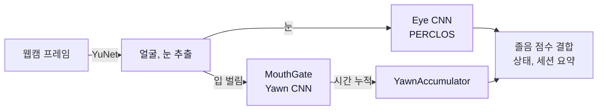
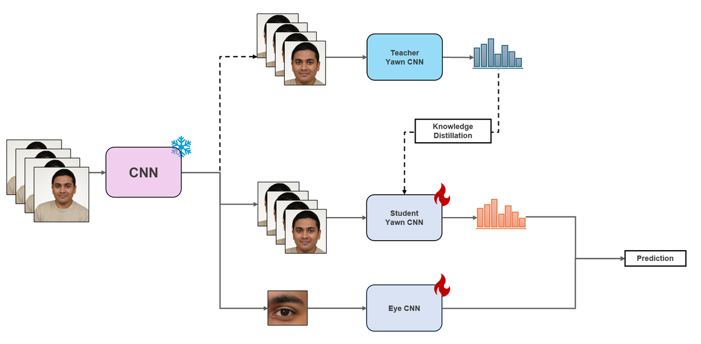
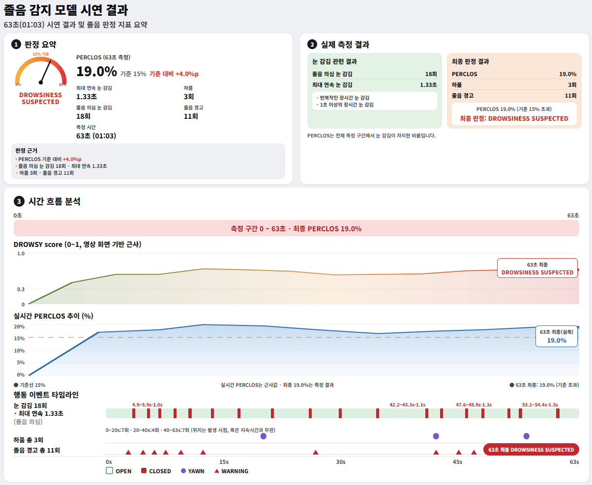

# Driver Drowsiness Detection

## Overview

웹캠에서 **눈 감김과 하품을 인식**하고 시간에 따른 변화를 합쳐 졸음 의심 상태를 표시하는 시스템. YuNet 얼굴 검출, 눈과 하품 CNN, PERCLOS와 하품 시간 누적을 결합하고 세션 종료 후 측정 지표 요약.

   

## Data

| Item | Details |
|---|---|
| Eye | **MRL Eye, DMD**, 눈 뜸과 감김 분류 |
| Yawn | **DMD, YawDD**, 입 벌림 프레임의 하품과 비하품 분류 |
| Input | 눈 또는 얼굴 crop, **128×128 그레이스케일** |
| Split | 피험자 기준 Train, Validation, Test 분리 |
| Access | 원본 영상과 crop 이미지는 미포함, 눈 학습 manifest와 집계표만 공개 |

## Research Design

1. **영상에서 얼굴과 눈 추출**

   - **YuNet**으로 얼굴을 검출하고 얼굴 좌표를 기준으로 눈과 얼굴 crop 생성
   - 프레임별 CNN 입력을 128×128 그레이스케일로 통일

2. **눈과 하품 CNN 학습 및 비교**

   - 눈 모델은 **MRL, DMD 단독 학습과 합본 학습, 미세조정** 비교
   - 하품 모델은 **CNN, MobileNetV2와 지식 증류** 실험을 비교하고 최종 `cnn_large` 채택
   - 저장된 평가값을 기준으로 모델 선택, 최종 추론에는 증류 Student 모델 미사용

3. **입이 열린 프레임에서 하품 분류**

   - **MediaPipe FaceLandmarker**로 입술 사이 거리를 눈 사이 거리로 나눈 `open_ratio` 계산
   - **MouthGate**의 입 벌림 기준을 넘는 프레임만 Yawn CNN에 전달. 학습과 추론에서 같은 기준 사용

4. **눈 감김과 하품을 시간축으로 누적**

   - **PERCLOS:** 최근 구간에서 눈이 감겨 있던 시간의 비율, 기본 창은 **60초**
   - **YawnAccumulator:** 하품 확률과 입 벌림 정도를 누적해 짧은 입 벌림과 말하기에 의한 오경보 억제
   - 연속된 하품은 프레임 수가 아닌 **한 번의 이벤트**로 집계

5. **신호 결합과 세션 요약**

   - 눈 감김 점수와 PERCLOS를 묶고 하품 누적 점수를 더해 **졸음 점수** 구성
   - 화면에 상태를 표시하고 측정 종료 후 눈 감김 횟수, 최대 지속시간, PERCLOS, 하품과 경고 횟수 출력

## Analysis Workflow



## Key Results

### Model Selection

- **눈 모델:** MRL과 DMD 합본 CNN 채택. DMD hold-out **3,805프레임**, 임계값 **0.93** 기준
- **하품 모델:** 입 벌림 데이터의 `cnn_large` 채택. 게이트 통과 Test **1,553장**, 임계값 **0.50** 기준

| Evaluation | Accuracy | Recall | Precision | F1 |
|---|---:|---:|---:|---:|
| Eye CNN, DMD hold-out | **0.9624** | 0.9138 | 0.7871 | 0.8457 |
| Yawn CNN, 게이트 통과 Test | **0.7521** | 0.6899 | 0.8118 | 0.7459 |
| Yawn, DMD 게이트 포함 평가 1,131장 | 0.779 | 0.518 | 0.993 | — |

평가 데이터와 조건이 달라 세 행의 직접 비교는 불가. 눈 Recall은 감김, 하품 Recall은 하품 클래스 기준.

<p align="center">
  
</p>
<p align="center"><sub>발표자료 12쪽의 모델 설계 그림. 지식 증류 비교 실험을 포함하며, 현재 최종 하품 추론 모델은 Student가 아닌 cnn_large.</sub></p>

### Session Summary

- 측정 종료 후 **눈 감김, 하품, 졸음 경고**를 세션 단위로 요약
- 발표자료에서는 **63초 시연**의 측정 지표와 시간 흐름을 아래 화면으로 정리

<p align="center">
  
</p>
<p align="center"><sub>발표자료 14쪽의 시연 요약 화면. DROWSY 곡선은 영상 화면을 바탕으로 그린 근사치이며 별도의 성능 평가가 아님.</sub></p>

## Limitations

- **입 가림:** DMD 평가에서 손으로 입을 가린 하품 Recall은 **0.162**, 랜드마크 기반 게이트가 주요 제약
- **환경과 개인차:** 조명, 안경, 얼굴 각도와 피험자에 따라 성능 차이 존재
- **초기 누적 구간:** PERCLOS 창이 충분히 쌓이기 전에는 해석에 주의 필요
- **적용 범위:** 공개 데이터셋 평가와 시연 기준의 프로토타입, 실제 도로 환경의 안전성 평가 결과는 아님

## Repository Structure

```text
├── model/      # 실시간 추론 Notebook, 모델 설정과 평가 지표
├── src/        # 전처리, CNN 학습, 게이트와 시간 누적
├── scripts/    # 데이터셋 구성 스크립트
├── outputs/    # 공개 학습 manifest와 집계표
├── docs/       # 모델 설명과 발표자료 그림
└── data/       # 원자료 배치 안내
```

[Model](model/README.md), [Source](src/README.md), [Scripts](scripts/README.md), [Data](data/README.md), [Results](outputs/README.md), [Figures](docs/figures/README.md)
